# Aries brand concepts

Logo marks for Aries and ariesworx.com. Theme: **celestial navigation**
(the naming family already in the product: Aries, Bearings, Sextant) - not
astrology, and no ram's head.

## Selected mark: Celestial Fix — Airy (F5)

Open triangle with star vertices and a brass fix. No medians, no hub ring —
weight in the frame and the fix. Chosen from the Fix iteration (E5 → E2 → F5).

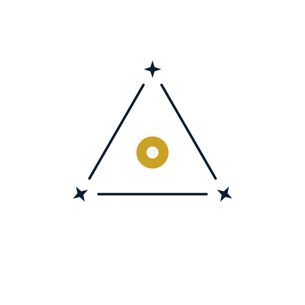

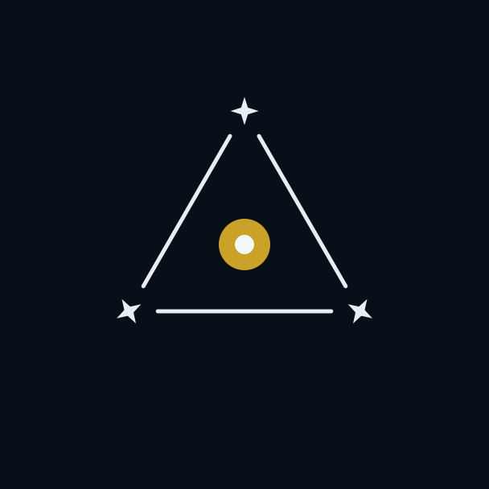

| Use | File |
|---|---|
| SVG (light grounds) | [`logos/aries-mark.svg`](logos/aries-mark.svg) |
| SVG (dark grounds) | [`logos/on-dark/aries-mark.svg`](logos/on-dark/aries-mark.svg) |
| PNG 512 / 128 / 64 | [`png/aries-mark-512.png`](png/aries-mark-512.png) · [128](png/aries-mark-128.png) · [64](png/aries-mark-64.png) |

Alias: `logos/fix-airy.svg` (same artwork).

**To browse earlier concepts:** open [`chooser.html`](chooser.html) or the
PNGs under [`review/`](review/). SVG files are source code; editors often
show their XML instead of a picture.

## All ten at a glance

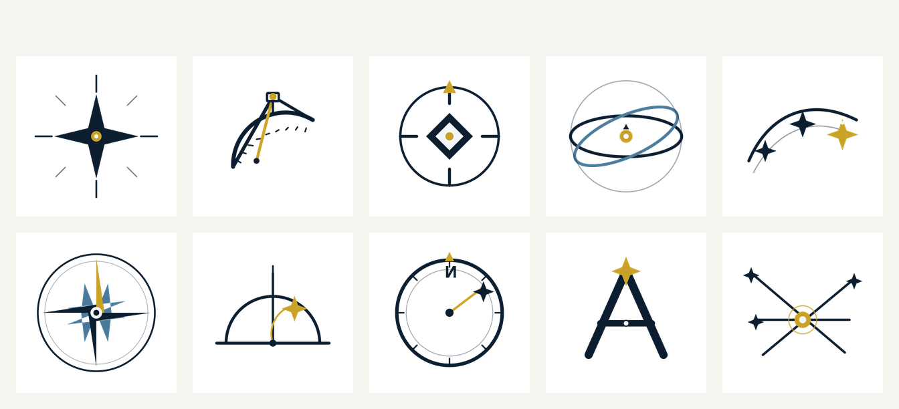

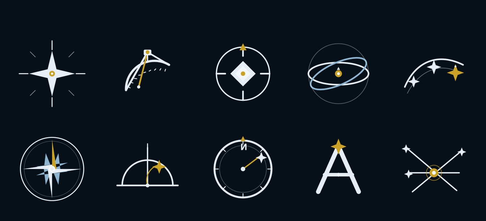

## Palette

| Token | Hex | Use |
|---|---|---|
| Ink | `#0B1D2E` | Primary mark, strokes |
| Brass | `#C9A227` | Accent (instrument metal / guide) |
| Sky | `#4A7A9B` | Secondary stroke (ecliptic, intercardinals) |
| Star | `#F4F7FA` | Small highlights on dark fills |

SVGs are the source of truth; they scale without loss. PNGs are raster
exports for places that want a bitmap (chat, GitHub social, etc.).

## The ten marks

Each row links the **PNG preview** (click to see the picture) and the SVG source.

### 01. Polaris

North star with compass rays. Strong at favicon size.

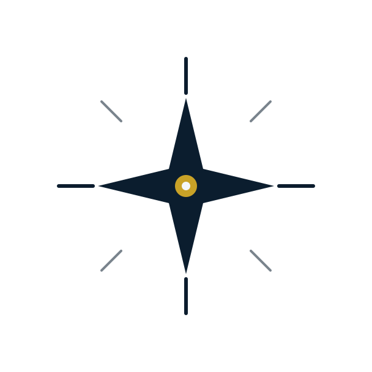

[SVG](logos/01-polaris.svg) · [PNG 512](png/01-polaris-512.png) · [on dark](review/01-polaris-on-dark.png)

### 02. Sextant

Graduated arc, index arm, horizon glass. Pairs with the Sextant binary.

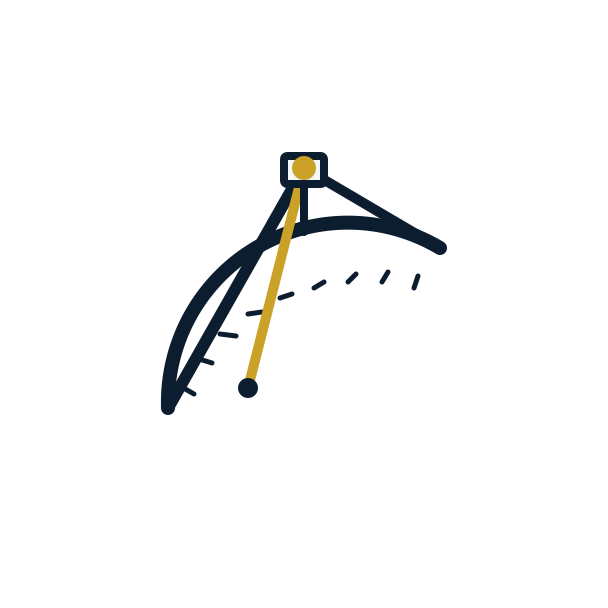

[SVG](logos/02-sextant.svg) · [PNG 512](png/02-sextant-512.png) · [on dark](review/02-sextant-on-dark.png)

### 03. Bearings

Cardinal ring and centered fix. Orchestrator / heading metaphor.

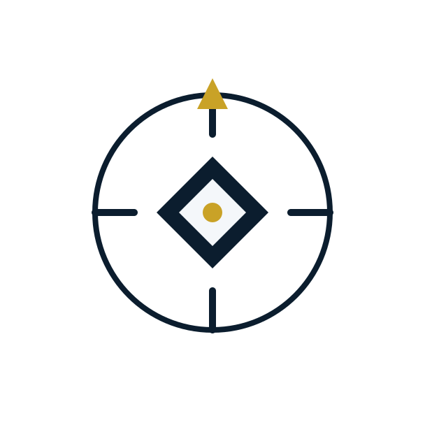

[SVG](logos/03-bearings.svg) · [PNG 512](png/03-bearings-512.png) · [on dark](review/03-bearings-on-dark.png)

### 04. First Point of Aries

Celestial equator crossed by the ecliptic. The navigational meaning of the name.

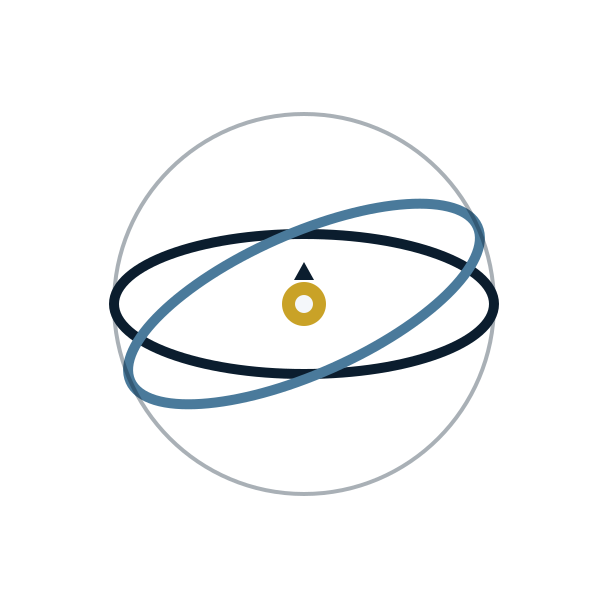

[SVG](logos/04-first-point.svg) · [PNG 512](png/04-first-point-512.png) · [on dark](review/04-first-point-on-dark.png)

### 05. Star Path

Guide stars along a great-circle course.

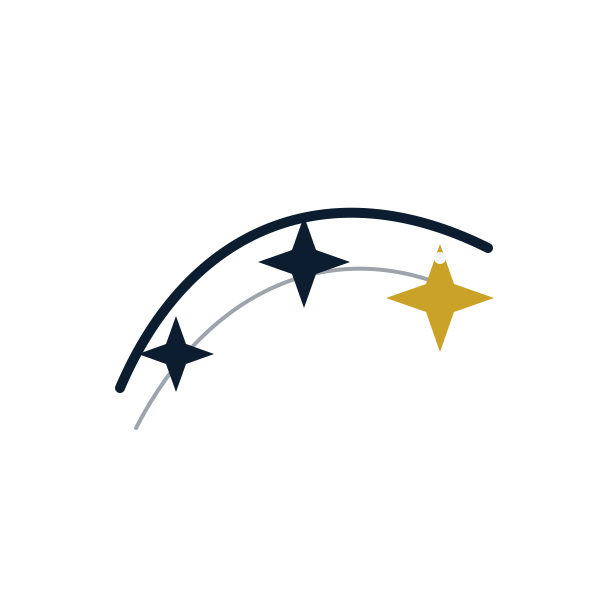

[SVG](logos/05-star-path.svg) · [PNG 512](png/05-star-path-512.png) · [on dark](review/05-star-path-on-dark.png)

### 06. Compass Rose

Eight-point rose with brass north.

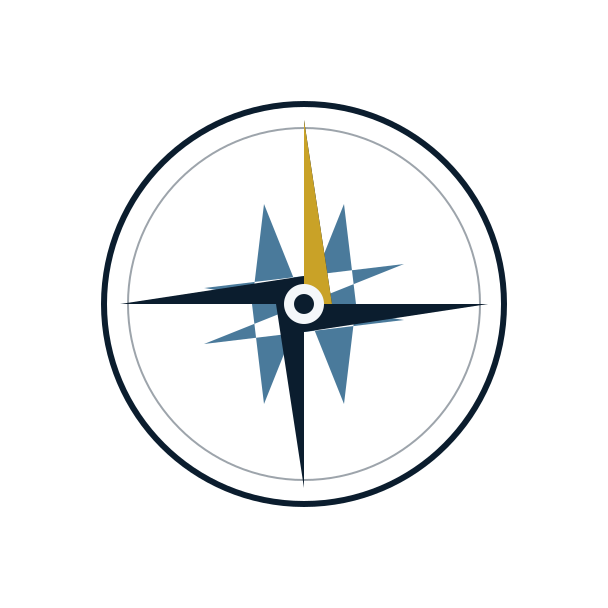

[SVG](logos/06-compass-rose.svg) · [PNG 512](png/06-compass-rose-512.png) · [on dark](review/06-compass-rose-on-dark.png)

### 07. Meridian

Horizon, meridian, and a star at altitude.

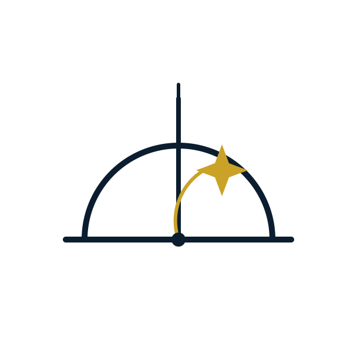

[SVG](logos/07-meridian.svg) · [PNG 512](png/07-meridian-512.png) · [on dark](review/07-meridian-on-dark.png)

### 08. Azimuth

Azimuth ring with a bearing to a guide star.

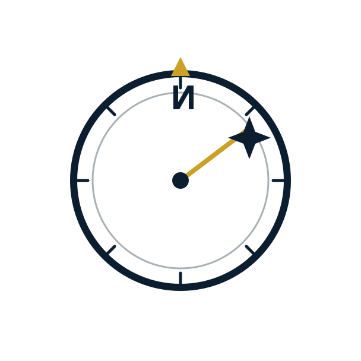

[SVG](logos/08-azimuth.svg) · [PNG 512](png/08-azimuth-512.png) · [on dark](review/08-azimuth-on-dark.png)

### 09. Sight A

Letter A as a navigational sight. Good wordmark lockup.

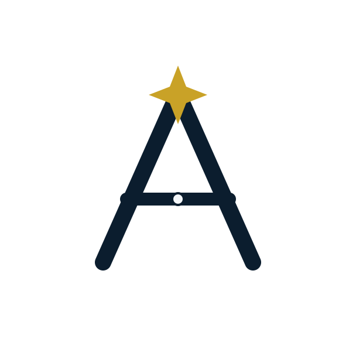

[SVG](logos/09-sight-a.svg) · [PNG 512](png/09-sight-a-512.png) · [on dark](review/09-sight-a-on-dark.png)

### 10. Celestial Fix

Three lines of position meet at one fix. Multi-agent coordination metaphor.

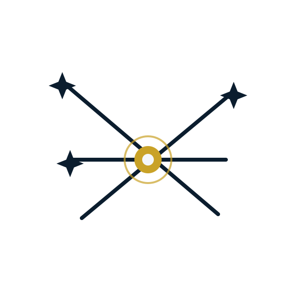

[SVG](logos/10-celestial-fix.svg) · [PNG 512](png/10-celestial-fix-512.png) · [on dark](review/10-celestial-fix-on-dark.png)


## Celestial Fix — finalists

Preference **E5 → E2**; selected **F5 Airy** (see Selected mark above). Finalists in
[`logos/fix-final/`](logos/fix-final/) — pick in
[`fix-final-chooser.html`](fix-final-chooser.html).

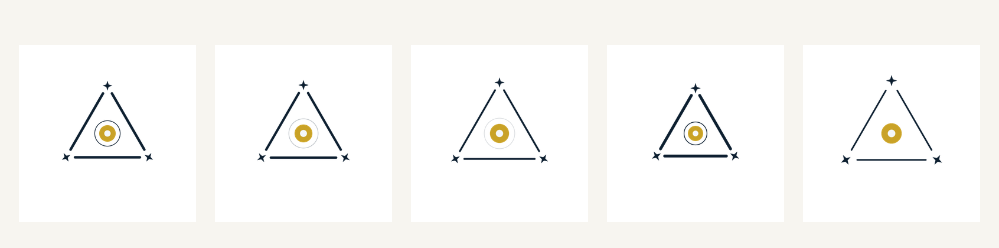

## Celestial Fix — E round

Shortlist was **E → D → B**. Five evolutions of the triangle live in
[`logos/fix-e-round/`](logos/fix-e-round/) — pick in
[`fix-e-chooser.html`](fix-e-chooser.html).

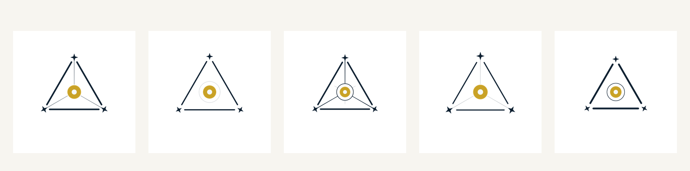

## Celestial Fix refinements

Mark 10 was the right idea but too rough. Five cleaned-up variations live in
[`logos/fix-variants/`](logos/fix-variants/) — compare them in
[`fix-chooser.html`](fix-chooser.html).

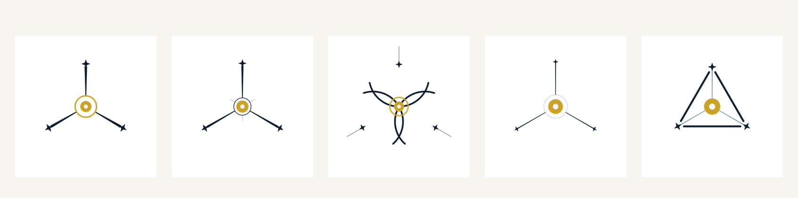

| ID | Name | Idea |
|---|---|---|
| 10a | Converge | Tapered sightlines stop at the fix |
| 10b | Precision | LOPs with soft stubs past a hub |
| 10c | Circles of Position | COP arcs meet at the fix |
| 10d | Minimal | Hairline rays, bold fix |
| 10e | Triangle | Sight triangle with star vertices |

## Files

```
docs/brand/
  README.md              # this page (renders the PNGs on GitHub)
  chooser.html           # interactive picker (self-contained; open in a browser)
  preview.html           # redirects to chooser.html
  logos/                 # SVG sources for light grounds
  logos/on-dark/         # Same marks with light ink for dark grounds
  png/                   # 64 / 128 / 512 px exports
  png/on-dark/
  review/                # Padded PNGs + contact sheets (easiest to view in the IDE)
```

## Suggested next steps

1. Pick a primary mark (favicon / GitHub social) and one wordmark lockup
   (often **09 Sight A** or **01 Polaris** + the word "Aries").
2. Add a monochrome (currentColor) cut of the winner for inline SVG in docs.
3. When the site lands, reuse the same SVG; do not redraw as a flat PNG hero.

## License

Same as the repository (AGPL-3.0-only). Marks are original geometric
artwork for Ariesworx LLC / the Aries project.
